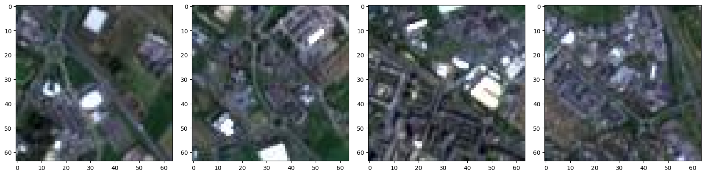
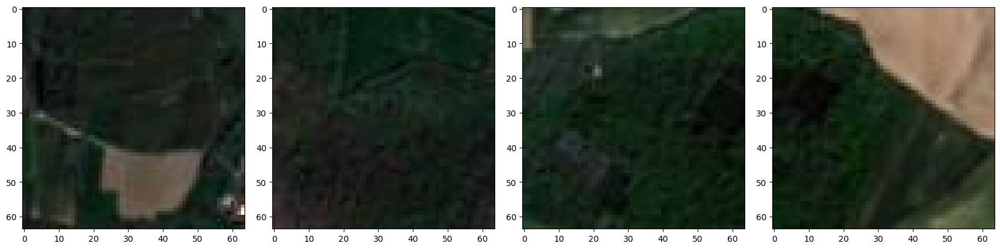

# Memory-Based vs Generator-Based Image Loading

A hands-on comparison of two ways to load image data in Python: **loading every image into memory at once (bulk loading)** versus **storing file paths and opening images one at a time on demand (sequential loading)**. The example uses a satellite-image dataset that separates agricultural land from non-agricultural land.


---

## Table of Contents

1. [Overview](#overview)
2. [Dataset](#dataset)
3. [What the Notebook Does](#what-the-notebook-does)
4. [Results](#results)
5. [Key Takeaways](#key-takeaways)
6. [Generator-Based Loading (Illustrative Sketch)](#generator-based-loading-illustrative-sketch)
7. [Repository Structure](#repository-structure)
8. [Getting Started](#getting-started)
9. [Limitations and Future Work](#limitations-and-future-work)
10. [Tech Stack](#tech-stack)
11. [Acknowledgements](#acknowledgements)
12. [License](#license)

---

## Overview

Image datasets are often too large to hold in RAM. Deep learning pipelines therefore need a data-loading strategy that is efficient in time and memory. This project walks through two common strategies:

| Strategy | How it works | Trade-off |
|---|---|---|
| **Bulk (memory-based)** | Read every image and keep all pixel arrays in memory | Simple code, but memory use grows with the dataset |
| **Sequential (path-based)** | Keep only a list of file paths and open each image when needed | Very small memory footprint, slightly more code |

The notebook builds both approaches on a binary land-use problem (agricultural vs non-agricultural land) and compares them in terms of code simplicity, memory use and I/O time.

## Dataset

Satellite image tiles, downloaded automatically in the notebook with the `skillsnetwork` library (a roughly 20 MB archive):

```
https://cf-courses-data.s3.us.cloud-object-storage.appdomain.cloud/5vTzHBmQUaRNJQe5szCyKw/images-dataSAT.tar
```

| Property | Value |
|---|---|
| Classes | 2 (`class_0_non_agri`, `class_1_agri`) |
| Images per class | **3,000** (6,000 in total) |
| Image size | 64 x 64 pixels, 3 color channels (RGB) |
| Format | JPEG |

```
images_dataSAT/
├── class_0_non_agri/    # non-agricultural land
└── class_1_agri/        # agricultural land
```

**Non-agricultural samples**



**Agricultural samples**



## What the Notebook Does

1. **Install and import** NumPy, Matplotlib, Pillow and `skillsnetwork`
2. **Download** the dataset from the cloud and extract it
3. **Read images with `os.scandir`** and inspect a single image (shape `(64, 64, 3)`)
4. **Bulk-load** all non-agricultural images into a NumPy array and time it
5. **Switch to path-based loading** with `os.listdir`, sort the file names and build a list of full paths
6. **Open and display images on demand** with Pillow and `plt.imshow`
7. **Repeat for the agricultural class**: build and sort `agri_images_paths`, count the files and display samples

## Results

| Check | Result |
|---|---|
| Shape of one image | `(64, 64, 3)` |
| Non-agricultural images | 3,000 |
| Agricultural images | 3,000 |
| Time to bulk-load the non-agricultural images into memory | about 1.4 s wall time (1.14 s CPU) |
| Memory for one class held as pixel arrays (calculated) | 3,000 x 64 x 64 x 3 bytes = about 35 MiB |

The memory figure is a calculation based on 8-bit pixels, not a measurement from the notebook. At this small image size, bulk loading is quick and the memory cost is modest. The gap grows quickly with larger images and more files.

## Key Takeaways

- **Bulk loading is simple and fast for small data**, but it keeps every pixel in RAM and does not scale to large datasets.
- **Path-based loading scales**: only a list of strings is held in memory, and each image is read only when it is needed.
- **Sorting file paths** makes the order reproducible, which is useful for debugging and for consistent train/validation splits.
- Reading from an iterator such as `os.scandir` consumes it. Entries already read are not available again, which is why a path list from `os.listdir` is easier to reuse.

## Generator-Based Loading (Illustrative Sketch)

The notebook stops at path-based loading. A generator is the natural next step: it keeps only the paths in memory and yields small batches of images. This sketch is not part of the notebook, but it was tested on sample images and returns arrays of shape `(batch, 64, 64, 3)`.

```python
import numpy as np
from PIL import Image

def image_batches(paths, batch_size=32):
    """Yield batches of images, loading only one batch into memory at a time."""
    for start in range(0, len(paths), batch_size):
        batch = [np.array(Image.open(p)) for p in paths[start:start + batch_size]]
        yield np.stack(batch)

# Example: uses agri_images_paths built in the notebook
for batch in image_batches(agri_images_paths, batch_size=32):
    print(batch.shape)   # (32, 64, 64, 3)
    break
```

## Repository Structure

```
memory-vs-generator-image-loading/
├── notebooks/
│   └── Memory_vs_Generator_Data_Loading.ipynb   # Full notebook with outputs
├── images/
│   ├── non_agricultural_samples.png
│   └── agricultural_samples.png
├── .gitignore
├── LICENSE
├── README.md
└── requirements.txt
```

## Getting Started

### Prerequisites

- Python 3.9 or newer
- An internet connection (the dataset downloads when the notebook runs)

### Installation

```bash
# 1. Clone the repository
git clone https://github.com/<your-username>/memory-vs-generator-image-loading.git
cd memory-vs-generator-image-loading

# 2. (Recommended) create a virtual environment
python -m venv .venv
source .venv/bin/activate        # Windows: .venv\Scripts\activate

# 3. Install dependencies
pip install -r requirements.txt
```

### Run the notebook

```bash
jupyter notebook notebooks/Memory_vs_Generator_Data_Loading.ipynb
```

Use **Kernel > Restart & Run All**. The dataset is extracted to `images_dataSAT/` (ignored by git).

> The download cell uses `await skillsnetwork.prepare(...)`, which is designed for Jupyter. If it does not work in your environment, download the archive from the URL above and extract it into the folder you run the notebook from.

## Limitations and Future Work

- The notebook demonstrates bulk and path-based loading but does not measure memory use directly. Adding `tracemalloc` or `psutil` measurements would back up the comparison with numbers.
- Timing is shown for bulk loading only. Timing the path-based approach, including opening every image, would make the comparison fair.
- Next steps: implement the generator as a `torch.utils.data.Dataset` / `DataLoader` or a Keras data generator, and train a small CNN to classify agricultural vs non-agricultural land.
- Add image preprocessing, such as normalization, resizing and augmentation, inside the loading pipeline.

## Tech Stack

- **Python**
- **NumPy**: array handling
- **Matplotlib** and **Pillow (PIL)**: reading and displaying images
- **skillsnetwork**: dataset download helper
- **Jupyter Notebook**

## Acknowledgements

- Built while studying the IBM AI Engineering course (IBM Skills Network). The dataset and the original lab structure are from that course and are © IBM Corporation.
- **My contribution:** I implemented and ran the loading experiments, answered the lab's questions, built the sorted path lists for both classes, wrote the generator-based loading example, and documented the findings and limitations.

## License

My code is released under the [MIT License](LICENSE). The lab instructions and dataset remain © IBM Corporation.
